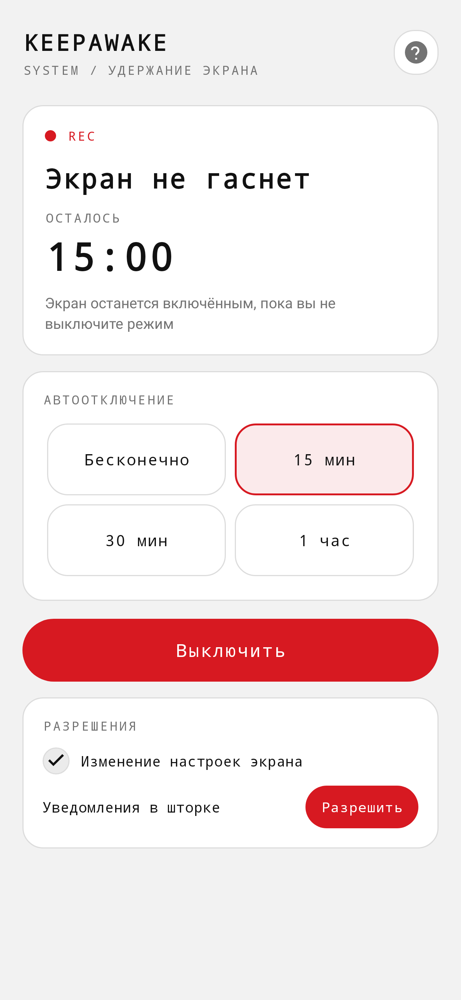
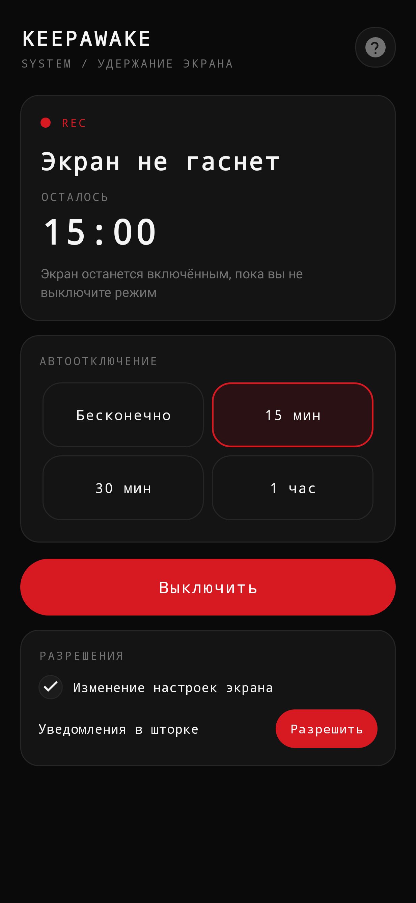

  
  <h1>KeepAwake</h1>
  
Минималистичная утилита удержания экрана Android в стиле Nothing OS 
  Minimalist Nothing OS-style keep-screen-on utility for Android

  

    
    
    
  

  <table>
    <tr>
      <td align="center"> Light</td>
      <td align="center"> Dark</td>
    </tr>
  </table>

> **Публичная бета / Public beta:** `v0.9.0-beta` (Pre-release). Основная логика покрыта 120 юнит-тестами, но поведение на разных OEM-прошивках может отличаться.  
> Core logic is covered by 120 unit tests, but behavior may vary across OEM firmware.

---

## Зачем нужен KeepAwake

- **Не даёт экрану погаснуть.** Удобно для рецептов, навигации, документации, дашбордов, отладки и любого сценария, где экран должен оставаться включённым.
- **Работает на агрессивных прошивках.** KeepAwake использует комбинацию `SCREEN_OFF_TIMEOUT` и `PowerManager.WakeLock` как страховку для оболочек вроде Realme UI, ColorOS, One UI, MIUI, которые могут сбрасывать нестандартно большой системный таймаут.
- **Быстрая плитка в шторке.** Включайте и выключайте режим одним тапом из Quick Settings — поддержка Android 14–16 с актуальным `PendingIntent` API.
- **Таймер автоотключения.** Бесконечный режим или автостоп через 15 / 30 / 60 минут.
- **Nothing OS стиль.** Монохромные светлая/тёмная темы, monospace-типографика, понятные состояния `STANDBY` / `REC`.

## Why KeepAwake?

- **Keeps your screen on.** Handy for recipes, navigation, docs, dashboards, debugging, or any case where the display must stay awake.
- **Built for aggressive OEM skins.** KeepAwake combines `SCREEN_OFF_TIMEOUT` with a `PowerManager.WakeLock` safety net for shells like Realme UI, ColorOS, One UI, MIUI that may reset unusually large timeout values.
- **Quick Settings tile.** Toggle the mode with one tap from the shade — Android 14–16 compatible, using the current `PendingIntent` tile API.
- **Auto-off timer.** Run indefinitely or auto-stop after 15 / 30 / 60 minutes.
- **Nothing OS look.** Monochrome light/dark themes, monospace typography, clear `STANDBY` / `REC` states.

---

## Разрешения

| Разрешение | Зачем нужно |
|---|---|
| `WRITE_SETTINGS` | Позволяет приложению менять системный таймаут экрана (`SCREEN_OFF_TIMEOUT`), пока активен режим удержания. Это основной механизм, который не даёт экрану погаснуть. |
| `POST_NOTIFICATIONS` | Нужно на Android 13+ для отображения уведомления foreground-сервиса со статусом и кнопкой быстрого выключения. |

Приложение также использует `WAKE_LOCK` и разрешения foreground-сервиса как часть внутренней логики удержания экрана. Интернет-доступа, аналитики и рекламы нет.

## Permissions

| Permission | Why it is needed |
|---|---|
| `WRITE_SETTINGS` | Lets the app modify the system screen timeout (`SCREEN_OFF_TIMEOUT`) while keep-awake mode is active. This is the core mechanism that prevents the display from sleeping. |
| `POST_NOTIFICATIONS` | Required on Android 13+ to show the foreground-service notification with status and a quick “Turn off” action. |

The app also uses `WAKE_LOCK` and foreground-service permissions internally as part of the keep-awake/safety-net behavior. No internet access, no analytics, no ads.

---

## Установка

1. Откройте раздел [Releases](../../releases) и скачайте `KeepAwake-v0.9.0-beta.apk`.
2. Разрешите установку из неизвестного источника, если Android попросит.
3. Установите APK (требуется Android 8.0 / API 24 или новее).
4. Запустите KeepAwake и выдайте разрешение **«Изменение системных настроек»** (`WRITE_SETTINGS`).
5. На Android 13+ разрешите уведомления для работы foreground-сервиса.
6. По желанию добавьте плитку **KeepAwake** в быстрые настройки для доступа из любого приложения.

> Текущая версия **v0.9.0-beta** — публичная бета (Pre-release), подписана developer-ключом. Play Protect может показать стандартное предупреждение для sideload-APK.

## Installation

1. Open the [Releases](../../releases) page and download `KeepAwake-v0.9.0-beta.apk`.
2. Allow installing from unknown sources if Android prompts you.
3. Install the APK (Android 8.0 / API 24 or newer required).
4. Launch KeepAwake and grant **Modify system settings** (`WRITE_SETTINGS`).
5. On Android 13+, allow notifications so the foreground service can show its status/control notification.
6. Optionally add the **KeepAwake** tile to Quick Settings for one-tap access from any app.

> The current **v0.9.0-beta** build is a public beta (Pre-release) signed with a developer key. Play Protect may show a generic warning for sideloaded APKs.

---

## License

MIT — see [LICENSE](LICENSE).
