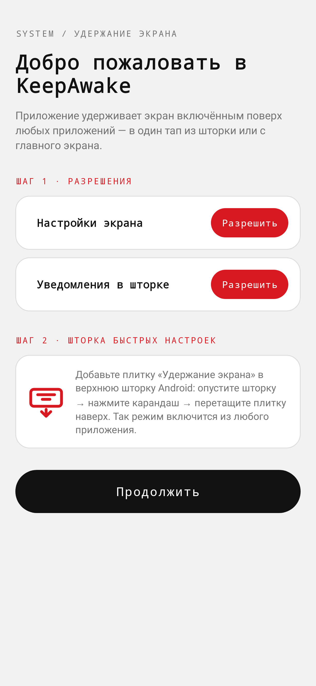
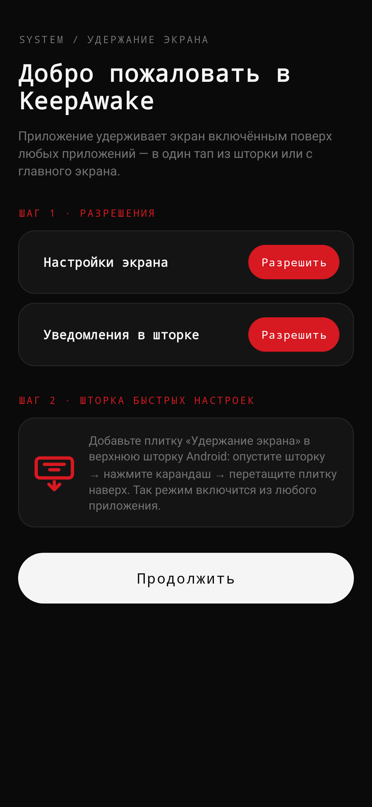

<p align="center">
  
</p>

<h1 align="center">KeepAwake</h1>

<p align="center">
  Minimalist Android utility that keeps your screen awake — Nothing OS monochrome style, a Quick Settings tile, and an optional countdown timer. No root, no ads, no telemetry.
</p>

<p align="center">
  
  
  
  
</p>

> **Status: public beta — v0.9.0-beta.** The core screen-holding logic, Quick Settings tile and timer are implemented and covered by 120 unit tests, but the app has not yet been battle-tested on every OEM firmware. Feedback and bug reports are welcome.

## Why KeepAwake?

Android turns the display off after a while, and some apps (recipes, dashboards, emulators, navigation, reading) simply need the screen to stay on. KeepAwake is a tiny, native-feeling tool for exactly that:

- **One tap, any app.** Toggle the mode from the main screen or straight from the Quick Settings shade.
- **Nothing OS aesthetics.** Monochrome light/dark palettes, monospace typography and `STANDBY` / `REC` status — no Material clutter.
- **Timed or indefinite.** Run forever (`∞`) or auto-stop after 15 minutes, 30 minutes or 1 hour. The remaining time stays visible on the tile.
- **Two layers of protection.** It pins the system `SCREEN_OFF_TIMEOUT` to “never” and additionally holds a `SCREEN_BRIGHT_WAKE_LOCK` as a safety net for shells that reset unusual timeout values.
- **Cleans up after itself.** The original timeout is restored on stop, timer expiry, screen-off, low battery, process restart and reboot. No permanent system changes.
- **Foreground service done right.** Android 14–16 compatible `specialUse` service, immutable `PendingIntent` for the tile, and no crashes when the system refuses a background start.

## How it works

1. `Settings.System.SCREEN_OFF_TIMEOUT` is saved, then set to `Int.MAX_VALUE` so Android itself stops dimming the display.
2. A `PowerManager.SCREEN_BRIGHT_WAKE_LOCK | ACQUIRE_CAUSES_WAKEUP` lock is acquired as a backup for Realme UI / ColorOS / MIUI-style skins that ignore or reset huge timeout values.
3. A foreground service keeps the mode alive and shows an ongoing notification with a stop action.
4. On stop, expiry, `ACTION_SCREEN_OFF`, low battery or reboot, the original timeout is restored and the wake lock is released.

## Permissions

| Permission | When | Why |
|---|---|---|
| `WRITE_SETTINGS` | Special app access, asked on first launch | The only way to change `SCREEN_OFF_TIMEOUT`. Without it the app cannot keep the screen on. |
| `POST_NOTIFICATIONS` | Android 13+, runtime prompt | Shows the ongoing foreground-service notification with the “Turn off” action. |
| `WAKE_LOCK` | Normal permission, no prompt | Holds the screen-bright wake lock as a safety net. |
| `FOREGROUND_SERVICE` / `FOREGROUND_SERVICE_SPECIAL_USE` | Normal permissions | Run the keep-awake service while the app is in the background. |

No internet permission, no analytics, no third-party SDKs.

## Installation

1. Open the [Releases](../../releases) page and download `KeepAwake-v0.9.0-beta.apk`.
2. On the phone, allow installing apps from your browser/file manager when Android asks.
3. Open the APK and install it. Android 8.0 (API 24) or newer is required.
4. Launch KeepAwake, grant **Modify system settings** and, on Android 13+, notification access.
5. Optionally add the **KeepAwake** tile to the Quick Settings shade: pull down the shade → pencil/edit → drag the tile into the active area.

> Since this is a beta signed with a self-generated key, Play Protect may show a generic warning for sideloaded APKs. The SHA-256 of the release asset is published in the release notes.

## Compatibility

- **Android 8.0 – 16** (API 24–35), targeting Android 15.
- Quick Settings tile verified with Robolectric on API 35, including the Android 14+ `PendingIntent` path.
- Works without root. OEM battery managers may still kill the foreground service; exclude KeepAwake from battery optimisation if the mode stops unexpectedly on Realme UI / ColorOS.

## Building from source

Requirements: JDK 17 and Android SDK 35.

```bash
git clone https://github.com/mrpixoff/KeepAwake.git
cd KeepAwake
./gradlew testDebugUnitTest      # 120 unit tests
./gradlew assembleDebug          # app/build/outputs/apk/debug/app-debug.apk
```

### Signed release build

Release signing is read from `keystore.properties` in the project root. Create it locally — **never commit it**:

```properties
storeFile=release.jks
storePassword=your-store-password
keyAlias=keepawake
keyPassword=your-key-password
```

Then:

```bash
./gradlew assembleRelease
# app/build/outputs/apk/release/app-release.apk
```

`release.jks`, `keystore.properties`, `local.properties`, `dist/` and generated screenshots are excluded by `.gitignore`.

## Tech stack

- Kotlin, coroutines and `StateFlow` as the single source of truth.
- Native XML views with View Binding — no Compose, no AppCompat.
- Foreground service with the `specialUse` type, broadcast receivers, Quick Settings tile.
- Robolectric 4.17 test suite: 120 tests, API 24/33/35, including real `Settings.System` wiring and native-graphics screenshot rendering.
- `0` lint errors.

## Русский

**KeepAwake** — минималистичная утилита для Android, которая не даёт экрану погаснуть. Оформление в духе Nothing OS: монохромные светлая и тёмная темы, monospace-типографика и статусы `STANDBY` / `REC`.

- Включение одним тапом с главного экрана или из плитки быстрых настроек.
- Бесконечный режим или таймер на 15 / 30 / 60 минут с обратным отсчётом.
- Удержание через `SCREEN_OFF_TIMEOUT = never` плюс страховочный `WakeLock` для прошивок Realme UI / ColorOS / MIUI.
- Автоматическое восстановление исходного таймаута при выключении, истечении таймера, выключении экрана, низком заряде и перезагрузке.
- Разрешения: «Изменение настроек экрана» (`WRITE_SETTINGS`) — чтобы менять системный таймаут; уведомления (`POST_NOTIFICATIONS`) — для постоянного уведомления с кнопкой «Выключить». Интернет-доступа и аналитики нет.

**Установка:** скачайте `KeepAwake-v0.9.0-beta.apk` из раздела [Releases](../../releases), разрешите установку из неизвестного источника и откройте файл. Требуется Android 8.0+. Версия находится в статусе публичной беты.

## License

MIT — see [LICENSE](LICENSE).
